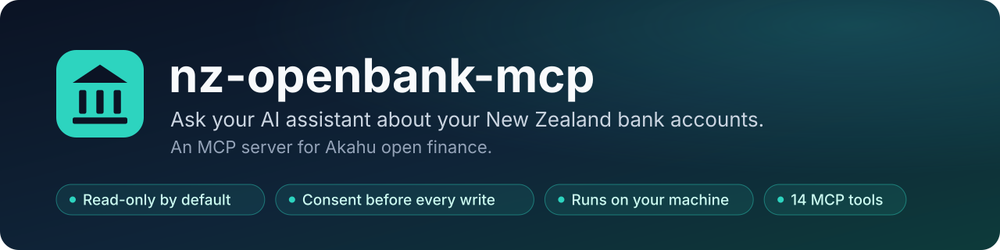
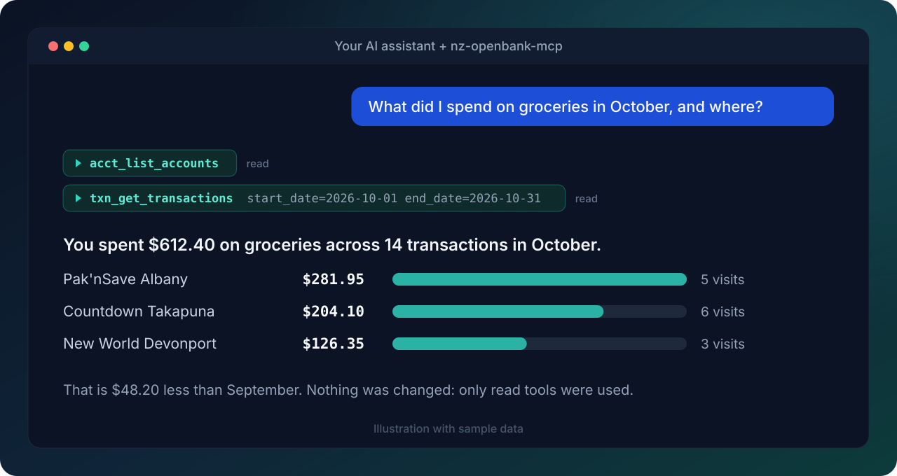

<p align="center">
  
</p>

<p align="center">
  <a href="https://pypi.org/project/nz-openbank-mcp/"></a>
  <a href="https://pypi.org/project/nz-openbank-mcp/"></a>
  <a href="https://github.com/thatskiff33/nz-openbank-mcp/actions/workflows/ci.yml"></a>
  <a href="https://github.com/thatskiff33/nz-openbank-mcp/actions/workflows/ci.yml"></a>
  <a href="https://github.com/thatskiff33/nz-openbank-mcp/blob/main/LICENSE"></a>
  <a href="https://github.com/thatskiff33/nz-openbank-mcp/releases/latest"></a>
  <a href="https://scorecard.dev/viewer/?uri=github.com/thatskiff33/nz-openbank-mcp"></a>
  <a href="https://glama.ai/mcp/servers/thatskiff33/nz-openbank-mcp"></a>
</p>

<p align="center">
  <a href="https://cursor.com/install-mcp?name=nz-openbank-mcp&config=eyJjb21tYW5kIjoidXZ4IiwiYXJncyI6WyJuei1vcGVuYmFuay1tY3AiXSwiZW52Ijp7IkFLQUhVX1VTRVJfVE9LRU4iOiIke2VudjpBS0FIVV9VU0VSX1RPS0VOfSIsIkFLQUhVX0FQUF9UT0tFTiI6IiR7ZW52OkFLQUhVX0FQUF9UT0tFTn0iLCJBS0FIVV9SRUFEX09OTFkiOiJ0cnVlIiwiQUtBSFVfQVVUT01BVElPTl9CWVBBU1MiOiJmYWxzZSJ9fQ%3D%3D"></a>
  <a href="https://github.com/thatskiff33/nz-openbank-mcp/releases/latest"></a>
  <a href="https://github.com/thatskiff33/nz-openbank-mcp#claude-code"></a>
</p>

Ask an AI assistant about your New Zealand bank accounts without handing your
banking credentials to anyone new. `nz-openbank-mcp` is a Model Context
Protocol server that talks to [Akahu](https://akahu.nz), the NZ open-finance
service, using a Personal App you create and control. It runs on your own
machine, starts read-only, and asks before anything changes.

<p align="center">
  
</p>

> Unofficial. Not affiliated with or endorsed by Akahu or any bank.

<!-- mcp-name: io.github.thatskiff33/nz-openbank-mcp -->

## Try asking

- "What did I spend on groceries last month, and at which shops?"
- "Which subscriptions am I paying for, and how much do they cost per year?"
- "Show my balances across every account."
- "Find every payment to my landlord this year."
- "Anything pending that has not settled yet?"
- "Compare my eating-out spend in September and October."

## Why it is safe to try

| | |
| --- | --- |
| **Read-only by default** | Write tools refuse until you set `AKAHU_READ_ONLY=false`. |
| **Consent per write** | With writes on, every write asks you first and shows exactly what will be sent. |
| **Local and private** | Runs on your machine over stdio and talks only to `api.akahu.io`. Tokens and transaction contents are never logged. |
| **Masked account numbers** | Only the bank code, the last four digits and the suffix are shown. |
| **Small and tested** | Thin wrappers over Akahu endpoints, strict typing, and 100% line and branch test coverage enforced in CI. |

[PyPI](https://pypi.org/project/nz-openbank-mcp/) ·
[Releases](https://github.com/thatskiff33/nz-openbank-mcp/releases) ·
[Security policy](https://github.com/thatskiff33/nz-openbank-mcp/blob/main/SECURITY.md)

## What it can do

The server exposes 14 tools. Ten only read; four change something and are
off until you turn writes on.

<details>
<summary><strong>All 14 tools</strong></summary>

| Tool | Writes? | Purpose |
| --- | --- | --- |
| `acct_list_accounts` | | Every connected account, with masked numbers and balances |
| `acct_get_account` | | One account by id |
| `acct_get_account_balance` | | Just the balance of one account |
| `acct_get_pending_transactions` | | Unsettled transactions for one account |
| `txn_get_transactions` | | Settled transactions, filtered by account, dates, category or amount (default 100) |
| `txn_get_transaction` | | One transaction by id |
| `txn_get_transactions_by_ids` | | Several transactions in one request |
| `txn_get_pending_transactions` | | Unsettled transactions across all accounts |
| `txn_search_transactions` | | Case-insensitive text search over description and merchant; without a start date, the 90 days up to the end date or today (default 50) |
| `id_get_me` | | The Akahu user's profile |
| `acct_refresh_all_accounts` | yes | Ask Akahu to fetch fresh data for every account |
| `acct_refresh_account` | yes | Ask Akahu to fetch fresh data for one account |
| `txn_report_transaction_issue` | yes | Open a support ticket with Akahu about a transaction |
| `id_verify_name` | yes | Check a name against the account holder; needs an extra scope (see [Limits](https://github.com/thatskiff33/nz-openbank-mcp#limits)) and may be charged per call |

</details>

There are no spending reports, budgets or forecasts built in. The assistant
works those out from the transactions, which keeps the server small and easy
to audit.

## Get your Akahu tokens

1. Sign in at [my.akahu.nz/developers](https://my.akahu.nz/developers) and
   create a Personal App.
2. Connect the bank accounts you want the assistant to see.
3. Copy the **App Token** (`app_token_...`) and **User Token**
   (`user_token_...`).

Treat both like passwords. The install steps below keep them out of project
files.

You also need [`uv`](https://docs.astral.sh/uv/). The plugins, the Desktop
Extension and the generic client setup all run the server with `uvx`, which
fetches the release and a matching Python.

## Install

| Where you use it | How | Where the tokens live |
| --- | --- | --- |
| Claude Code | Plugin from this repo's marketplace | OS keychain, prompted at install |
| Claude Desktop | `.mcpb` Desktop Extension | OS keychain, prompted at install |
| Codex | Plugin from this repo's marketplace | Environment Codex starts in |
| Cursor | Plugin from this repo's marketplace | Cursor plugin settings |
| Grok Build | Plugin from this repo's marketplace | Environment Grok starts in |
| claude.ai, ChatGPT, grok.com | Self-hosted HTTPS server with OAuth | Your server's environment |
| Anything else that speaks MCP | `uvx nz-openbank-mcp` | Environment of the client |

Every option below starts with `AKAHU_READ_ONLY=true` and
`AKAHU_AUTOMATION_BYPASS=false`.

### Claude Code

```text
/plugin marketplace add thatskiff33/nz-openbank-mcp
/plugin install nz-openbank-mcp@nz-openbank
```

Claude Code asks for both tokens and the two safety settings. `/mcp` should
then list the server as connected. To change a setting later, open `/plugin`,
pick the plugin and choose **Configure options**. More detail, including
updates and removal, is in [`plugin/README.md`](https://github.com/thatskiff33/nz-openbank-mcp/blob/main/plugin/README.md).

### Claude Desktop

Download `nz-openbank-mcp-X.Y.Z.mcpb` from the
[latest release](https://github.com/thatskiff33/nz-openbank-mcp/releases/latest)
and open it, or use **Settings -> Extensions -> Advanced -> Install
Extension**. Desktop shows a form for the tokens and settings. To update,
install the newer `.mcpb`.

The Claude Code plugin does not work in Claude Desktop, because Desktop cannot
collect plugin settings yet.

### Codex, Grok Build

Neither host can prompt for a plugin secret, so the tokens come from the
environment you start the host in. Read them from your OS secret store rather
than writing them into a dotfile:

```bash
# macOS
export AKAHU_USER_TOKEN="$(security find-generic-password -s akahu-user-token -w)"
export AKAHU_APP_TOKEN="$(security find-generic-password -s akahu-app-token -w)"
# Linux (libsecret)
export AKAHU_USER_TOKEN="$(secret-tool lookup service akahu-user-token)"
export AKAHU_APP_TOKEN="$(secret-tool lookup service akahu-app-token)"
```

In Codex, Grok Build and Cursor, an `AKAHU_READ_ONLY` or
`AKAHU_AUTOMATION_BYPASS` already set in the environment the host starts in
overrides the safe defaults.

Codex:

```bash
codex plugin marketplace add thatskiff33/nz-openbank-mcp
codex plugin add nz-openbank-mcp@nz-openbank
codex mcp list          # shows the akahu server
```

Codex passes only the four `AKAHU_*` settings through to the server. Update
with `codex plugin marketplace upgrade nz-openbank`.

Grok Build:

```bash
grok plugin marketplace add thatskiff33/nz-openbank-mcp
grok plugin install nz-openbank-mcp --trust
grok mcp doctor akahu   # should report 14 tools
```

Grok also loads Claude Code plugins. Install in one of the two, not both, or
you get two copies of the server.

### Cursor

```bash
agent plugin marketplace add https://github.com/thatskiff33/nz-openbank-mcp
```

Install **nz-openbank-mcp** from **Customize** (or `/plugins` in the Cursor
CLI), then enter the two tokens under **Plugins -> Configure**. Cursor stores
them, not the repo. Leave the safety settings empty to keep the defaults. The
server shows up as `plugin-nz-openbank-mcp-akahu`. Settings left unset there
fall back to the environment Cursor started in. To try a local checkout, start
the Cursor CLI with `--plugin-dir /path/to/nz-openbank-mcp/plugin`.

The **Add to Cursor** button at the top installs a plain MCP entry instead of
the plugin. It reads `AKAHU_USER_TOKEN` and `AKAHU_APP_TOKEN` from the
environment Cursor starts in, so set them as shown for Codex above.

### Web connectors (claude.ai, ChatGPT, grok.com)

Web assistants can only reach servers on the public internet. Run the
`nz-openbank-mcp-http` entrypoint behind HTTPS with OAuth, then add a custom
connector in the assistant (for grok.com, at grok.com/connectors) pointing at
the server's `/mcp` URL. In OAuth mode this server acts as the OAuth
authorization server, Google confirms who is signing in, and only the Google
accounts or Workspace domains you allow get through. Google never sees your
Akahu tokens.

Setup, the Google client, the redirect allowlist and hardening are covered in
[docs/public-https-streamable-http.md](https://github.com/thatskiff33/nz-openbank-mcp/blob/main/docs/public-https-streamable-http.md),
with a systemd example under [`deploy/linux-systemd/`](https://github.com/thatskiff33/nz-openbank-mcp/tree/main/deploy/linux-systemd).
grok.com's connector callback,
`https://grok.com/connectors-oauth-exchange-code/`, is not in the default
redirect list. `NZ_OPENBANK_MCP_ALLOWED_REDIRECT_URIS` replaces that list, so
include any default entries you still need alongside it.

### Any other MCP client

Point the client at this command and give it the settings as environment
variables:

```bash
uvx nz-openbank-mcp            # or pin: uvx --from nz-openbank-mcp==X.Y.Z nz-openbank-mcp
```

[`examples/claude_desktop_config.json`](https://github.com/thatskiff33/nz-openbank-mcp/blob/main/examples/claude_desktop_config.json)
shows the shape most JSON-configured clients expect. To use it with Claude
Desktop instead of the extension, merge it into the config file and restart:

- macOS: `~/Library/Application Support/Claude/claude_desktop_config.json`
- Windows: `%APPDATA%\Claude\claude_desktop_config.json`
- Linux: `~/.config/Claude/claude_desktop_config.json`

### Docker

Each release is also published as a multi-arch image (amd64 and arm64), running
as a non-root user with read-only mode on:

```bash
docker run -i --rm -e AKAHU_USER_TOKEN -e AKAHU_APP_TOKEN ghcr.io/thatskiff33/nz-openbank-mcp
```

`-e NAME` with no value passes the variable through from your shell, so the
tokens stay out of the command line. For a JSON-configured client, use
`"command": "docker"` with those arguments. For the HTTP server, run
`nz-openbank-mcp-http` in the image; see the HTTPS guide.

## Settings

The server reads settings from its process environment, plus an env file only
when `AKAHU_ENV_FILE` names one (process values win). It never picks up a
`.env` file from the working directory.

| Variable | Default | Meaning |
| --- | --- | --- |
| `AKAHU_USER_TOKEN` | (required) | Your User Token |
| `AKAHU_APP_TOKEN` | (required) | Your Personal App's App Token |
| `AKAHU_READ_ONLY` | `true` | Refuse every write tool |
| `AKAHU_AUTOMATION_BYPASS` | `false` | Skip the confirmation prompt for the two refresh tools |
| `AKAHU_REQUEST_TIMEOUT` | `10` | Seconds per Akahu request (1 to 120) |
| `AKAHU_LOG_LEVEL` | `INFO` | `DEBUG`, `INFO`, `WARNING`, `ERROR` or `CRITICAL` |
| `AKAHU_ENV_FILE` | (unset) | Absolute path to an env file to load; on Linux and macOS it must be yours (or root's) and not writable by group or others |
| `AKAHU_BASE_URL` | `https://api.akahu.io/v1` | Must stay on `api.akahu.io` unless the next setting is on |
| `AKAHU_ALLOW_CUSTOM_BASE_URL` | `false` | Allow another API host; honoured only from the process environment, never from an env file |

The server logs a warning at startup when a custom API host is in use. Set
`AKAHU_ENV_FILE` and `AKAHU_ALLOW_CUSTOM_BASE_URL` only in your own shell or
host config, never in project files of a repository you cloned.

The HTTP entrypoint has its own `NZ_OPENBANK_MCP_*` settings, listed in
[`.env.example`](https://github.com/thatskiff33/nz-openbank-mcp/blob/main/.env.example) and the HTTPS guide.

## How writes are guarded

Three checks sit in front of every write tool:

1. **Read-only switch.** With `AKAHU_READ_ONLY=true` the tool refuses before
   any request leaves your machine.
2. **Confirmation.** With writes on, the server asks you to approve each call
   through your assistant's confirmation prompt. The prompt lists every value
   that will be sent, such as the full text of a support ticket comment, in
   quotes with hidden characters made visible. Values over 1,000 characters
   are refused rather than shortened. Declining or dismissing the prompt
   cancels the call.
3. **Narrow bypass.** `AKAHU_AUTOMATION_BYPASS=true` skips the prompt only for
   `acct_refresh_all_accounts` and `acct_refresh_account`, which just ask Akahu
   to re-sync. Each skipped prompt is logged, the startup banner lists these
   tools, and the server will not start with the bypass on while read-only is
   also on. Support tickets and name checks always ask.

## Limits

Akahu Personal Apps cannot reach app-scoped endpoints, so this server has no
tools for categories (transactions carry theirs inline), the list of supported
banks, payments or webhooks.

`id_verify_name` needs a scope you enable for your Personal App at
[my.akahu.nz/developers](https://my.akahu.nz/developers); without it Akahu
answers 403.

Pending transactions have no id, can change before they settle, and are
marked `"pending": true`.

`txn_get_transactions` and `txn_search_transactions` read at most 20 pages
of results from Akahu per call. When a range holds more, the result has
`"truncated": true`; ask again with a narrower date range.

Reads and account refreshes are tried up to three times on network errors
and Akahu server errors. Support tickets and name checks are sent once,
because a request that timed out may still have reached Akahu. Rate-limit
(429) responses are retried for every request.

## Dates and amounts

Dates are New Zealand calendar days (`Pacific/Auckland`), even though Akahu
stores UTC timestamps. A date-only filter such as `start_date=2026-10-18`
covers that whole NZ day, at either end of a range; a full ISO 8601 timestamp
is passed to Akahu unchanged, and Akahu reads one without an offset as UTC.
Amounts are formatted in each account's currency, so a USD account shows
`-USD 9.99`. When an account's currency is unknown, `currency` is `null` and
`amount` has no currency symbol (for example `-1,234.50`); `amount_raw` is
the same amount as a plain number, rounded to cents. Other date formats are
rejected.

## Privacy

- NZ account numbers are masked to the bank code, the last four account
  digits and the suffix. In any other format, every digit but the last four
  is masked.
- Tokens are never logged. Balances and transaction contents are not logged;
  request paths, which can include Akahu account or transaction ids, are
  logged with their status.
- By default, over stdio, the server's only network traffic is to
  `api.akahu.io` (plus `uvx` downloading the package). HTTP mode adds Google
  for sign-in.
- Account and date filters are sent to Akahu; category and amount filters are
  applied after the data arrives. Personal Apps have no finer-grained access
  control, so the token can read everything you connected.

Release files (wheel, sdist and `.mcpb`) carry GitHub build provenance, and
PyPI uploads come from Trusted Publishing. To check a download:

```bash
gh attestation verify nz-openbank-mcp-X.Y.Z.mcpb --repo thatskiff33/nz-openbank-mcp
```

Report vulnerabilities privately through [`SECURITY.md`](https://github.com/thatskiff33/nz-openbank-mcp/blob/main/SECURITY.md).

## Development

```bash
git clone https://github.com/thatskiff33/nz-openbank-mcp.git
cd nz-openbank-mcp
uv sync --extra dev
uv run pytest                 # 100% line and branch coverage is required
uv run ruff check . && uv run mypy src
FASTMCP_ENV_FILE=/dev/null uv run fastmcp dev src/nz_openbank_mcp/server.py
```

To use a local checkout from Claude Code:

```bash
claude mcp add nz-openbank --scope user \
  --env AKAHU_APP_TOKEN=app_token_... --env AKAHU_USER_TOKEN=user_token_... \
  -- uv --directory "$(pwd)" run nz-openbank-mcp
```

The host plugin manifests are generated. Edit `plugin/plugin.base.toml`, then
run `uv run --no-project python scripts/sync_plugin_manifests.py`. Releases
are described in [`PUBLISHING.md`](https://github.com/thatskiff33/nz-openbank-mcp/blob/main/PUBLISHING.md); further operator guides are
in [`docs/`](https://github.com/thatskiff33/nz-openbank-mcp/tree/main/docs).

## License and disclaimer

Licensed under Apache-2.0; see [`LICENSE`](https://github.com/thatskiff33/nz-openbank-mcp/blob/main/LICENSE).
Derived from [nz-akahu-mcp](https://github.com/severity1/nz-akahu-mcp) by
severity1 (Apache-2.0) and substantially modified; see
[`NOTICE`](https://github.com/thatskiff33/nz-openbank-mcp/blob/main/NOTICE).
Thank you to severity1 for building and open-sourcing the original, which
this project would not exist without.

This software is provided as is. You are responsible for how you use it with
your financial data. The maintainers accept no liability for data loss,
unauthorised access or financial loss arising from its use.
